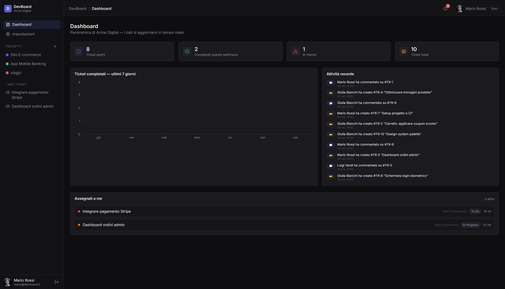
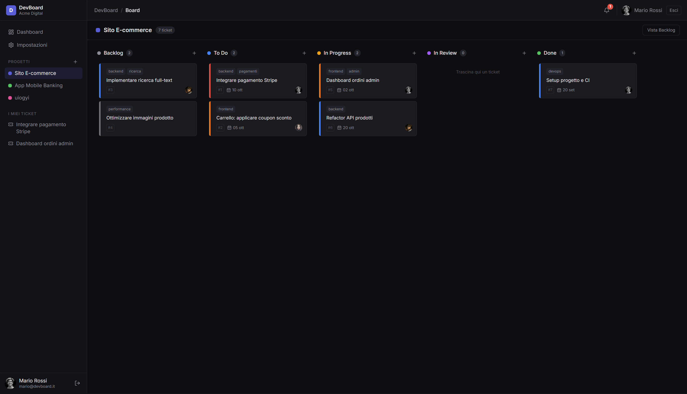
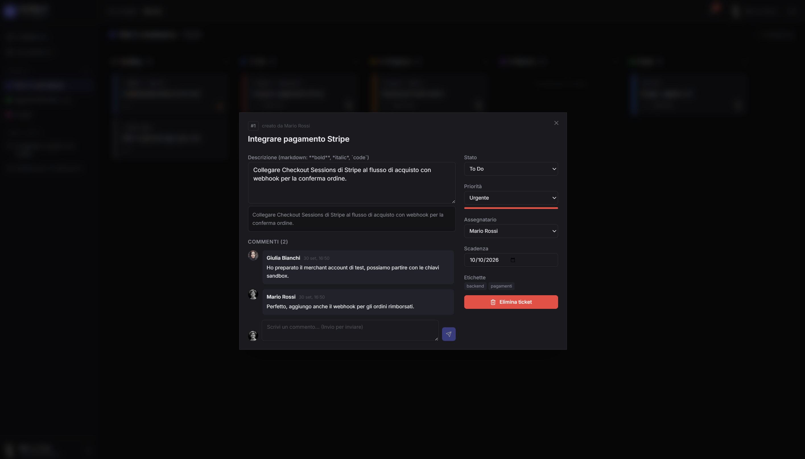

# DevBoard

> Project management tool real-time in stile Linear/Jira — board kanban con drag & drop, commenti live, notifiche push e autenticazione JWT.





---

## Architettura

```
┌──────────────────────────────┐        ┌───────────────────────────────┐
│  FRONTEND (React + Vite)     │  REST  │  BACKEND (Express + Socket.io)│
│  localhost:5173              │◀──────▶│  localhost:4000               │
│                              │        │                               │
│  • Zustand   (stato globale) │  WS    │  • JWT access 15m             │
│  • React Query (cache dati)  │◀──────▶│  • Refresh token 7g (cookie)  │
│  • @dnd-kit  (drag & drop)   │Socket  │  • RBAC owner/admin/member    │
│  • Framer Motion (animazioni)│        │  • Zod (validazione input)    │
└──────────────────────────────┘        └──────────────┬────────────────┘
                                                       │ connection pool
                                                       ▼
                                            ┌─────────────────────┐
                                            │  MySQL (devboard)   │
                                            │  8 tabelle + demo   │
                                            └─────────────────────┘
```

**Flusso real-time:** ogni modifica a un ticket nel backend viene emessa nella room
`progetto:{id}` (es. `ticket:creato`, `ticket:spostato`), così tutti i membri del progetto
vedono la board aggiornarsi senza refresh. Le notifiche personali arrivano nella room
`utente:{id}` e alimentano il badge della campanella.

---

## Tech Stack

| Layer     | Tecnologie |
|-----------|------------|
| Frontend  | React 18 · Vite · TypeScript · Tailwind CSS 4 · shadcn/ui-style components · Zustand · TanStack React Query · React Router v6 · socket.io-client · @dnd-kit · Framer Motion · react-hook-form + zod · recharts |
| Backend   | Node.js · Express · Socket.io · mysql2 (pool) · jsonwebtoken · bcryptjs · zod · cors · helmet · express-rate-limit · cookie-parser · dotenv |
| Database  | MySQL 8 — 8 tabelle (`utenti`, `workspace`, `workspace_members`, `progetti`, `ticket`, `commenti`, `notifiche`) con dati demo realistici |

---

## Requisiti

- Node.js ≥ 18 (testato con Node 22)
- MySQL 8.x in esecuzione
- Git (e [GitHub CLI](https://cli.github.com/) per il push su GitHub)

---

## Installazione

### Quick start (un solo comando)

```bash
npm install         # alla root: installa "concurrently"
npm run dev         # avvia backend (:4000) + frontend (:5173) insieme
```

oppure, preferendo due terminali distinti:

### 1. Database

```bash
cd backend
mysql -u root -p < database/schema.sql
```

Lo script crea il database `devboard`, tutte le tabelle e i **dati demo**:
3 utenti, 1 workspace, 2 progetti, 10 ticket distribuiti su 5 colonne, commenti e notifiche.

### 2. Backend

```bash
cd backend
cp .env.example .env      # Windows: copy .env.example .env
# compila DB_PASSWORD e i segreti JWT nel file .env
npm install
npm run dev               # avvia su http://localhost:4000
```

Verifica: `curl http://localhost:4000/api/health` → `{"ok":true,"servizio":"devboard"}`

### 3. Frontend

```bash
cd frontend
cp .env.example .env      # Windows: copy .env.example .env
npm install
npm run dev               # avvia su http://localhost:5173
```

Apri **http://localhost:5173** e accedi con un account demo.

---

## Account demo

| Nome           | Email             | Password     | Ruolo    |
|----------------|-------------------|--------------|----------|
| Mario Rossi    | mario@devboard.it | Password123! | owner    |
| Giulia Bianchi | giulia@devboard.it| Password123! | admin    |
| Luigi Verdi    | luigi@devboard.it | Password123! | member   |

Le password sono hash bcrypt già inclusi nello `schema.sql`.

---

## Variabili d'ambiente

### `backend/.env`

| Variabile | Descrizione | Esempio |
|-----------|-------------|---------|
| `PORT` | Porta del server API | `4000` |
| `CLIENT_ORIGIN` | Origine CORS del frontend | `http://localhost:5173` |
| `DB_HOST` / `DB_PORT` | Host e porta MySQL | `localhost` / `3306` |
| `DB_USER` / `DB_PASSWORD` | Credenziali MySQL | `root` / `***` |
| `DB_NAME` | Nome del database | `devboard` |
| `JWT_SECRET` | Segreto access token (15 min) | stringa lunga casuale |
| `JWT_REFRESH_SECRET` | Segreto refresh token (7 giorni) | stringa lunga casuale |
| `JWT_EXPIRES_IN` | Scadenza access token | `15m` |
| `JWT_REFRESH_EXPIRES_IN` | Scadenza refresh token | `7d` |
| `REFRESH_COOKIE_NAME` | Nome del cookie httpOnly | `devboard_refresh` |
| `DB_POOL_LIMIT` | Dimensione pool MySQL | `10` |

### `frontend/.env`

| Variabile | Descrizione | Esempio |
|-----------|-------------|---------|
| `VITE_API_URL` | URL base dell'API | `http://localhost:4000` |
| `VITE_SOCKET_URL` | URL del server Socket.io | `http://localhost:4000` |

---

## API REST

```
AUTH        POST   /api/auth/register · /api/auth/login · /api/auth/refresh
            DELETE /api/auth/logout            GET /api/auth/me

WORKSPACE   GET    /api/workspace
            POST   /api/workspace
            GET    /api/workspace/:slug
            POST   /api/workspace/:id/invita
            DELETE /api/workspace/:id/membri/:userId
            GET    /api/workspace/:id/membri
            GET    /api/workspace/:id/stats      (dashboard)
            GET    /api/workspace/:id/attivita   (timeline)

PROGETTI    GET    /api/workspace/:id/progetti
            POST   /api/workspace/:id/progetti
            PUT    /api/progetti/:id
            DELETE /api/progetti/:id            (solo admin/owner)

TICKET      GET    /api/progetti/:id/ticket
            POST   /api/progetti/:id/ticket
            GET    /api/ticket/:id
            PUT    /api/ticket/:id
            DELETE /api/ticket/:id
            PATCH  /api/ticket/riordina         (drag & drop)
            PATCH  /api/ticket/:id/assegna

COMMENTI    GET    /api/ticket/:id/commenti
            POST   /api/ticket/:id/commenti
            DELETE /api/commenti/:id

NOTIFICHE   GET    /api/notifiche
            PATCH  /api/notifiche/:id/letta
            PATCH  /api/notifiche/lettre        (tutte come lette)
```

### Eventi Socket.io

| Direzione | Evento | Effetto |
|-----------|--------|---------|
| server → client | `ticket:creato` | aggiunge la card alla board |
| server → client | `ticket:aggiornato` | aggiorna la card per tutti |
| server → client | `ticket:spostato` | sincronizza il drag & drop |
| server → client | `ticket:eliminato` | rimuove la card |
| server → client | `commento:nuovo` | commento real-time nel modal |
| server → client | `notifica:nuova` | badge campanella in navbar |
| client → server | `join:progetto` / `leave:progetto` | entra/esce dalla room del progetto |

---

## Struttura del progetto

```
devboard/
├── backend/
│   ├── src/
│   │   ├── config/database.js      # pool MySQL
│   │   ├── middleware/auth.js      # verifica JWT
│   │   ├── middleware/ruolo.js      # RBAC (solo admin può eliminare)
│   │   ├── routes/                 # auth, workspace, progetti, ticket, commenti, notifiche, dashboard
│   │   ├── socket/events.js        # eventi Socket.io + autenticazione handshake
│   │   └── server.js
│   ├── database/schema.sql         # schema + dati demo
│   ├── .env.example
│   └── package.json
├── frontend/
│   ├── src/
│   │   ├── components/{ui,layout,board,ticket,notifiche}
│   │   ├── pages/                  # Login, Register, Dashboard, Board, Backlog, Impostazioni
│   │   ├── hooks/                  # useAuth, useSocket, useNotifiche
│   │   ├── store/                  # authStore, boardStore (Zustand)
│   │   ├── services/api.ts         # axios + interceptor JWT silenzioso
│   │   ├── types/ · utils/
│   │   └── App.tsx · main.tsx
│   ├── .env.example
│   └── package.json
└── README.md
```

---

## Sicurezza

- **Access token in memoria** (mai `localStorage`) + **refresh token in cookie httpOnly** da 7 giorni con rotazione ad ogni uso.
- `helmet`, `cors` con origine limitata, `express-rate-limit` (globale + stretto su auth).
- Password hashate con **bcryptjs** (10 salt rounds).
- Tutti gli input validati con **zod** lato server; i ticket/commenti sono accessibili solo ai membri dello workspace (controllo membership su ogni query).
- RBAC: solo `owner`/`admin` possono eliminare progetti e gestire i membri.

## Deploy

> ⚠️ **Importante:** Vercel ospita solo il **frontend**. Il backend (Express + Socket.io
> persistenti) e il database MySQL **non possono girare su Vercel** (è una piattaforma
> serverless senza WebSocket e senza MySQL). Architettura consigliata:
>
> `Vercel (frontend)` ──REST/WS──► `Render/Railway (backend)` ──► `MySQL gestito`

### 1. Frontend su Vercel

1. [vercel.com](https://vercel.com) → **Add New → Project** → importa il repo `Luis-Miha/devboard`
2. **Settings → General → Root Directory**: imposta `frontend` (fondamentale: il repo è un monorepo)
3. Framework preset: **Vite** (rilevato automaticamente) · Build Command `npm run build` · Output Directory `dist`
4. **Settings → Environment Variables** (obbligatorie **prima** del primo build, sono compile-time):
   - `VITE_API_URL` = `https://<nome-backend>.onrender.com`
   - `VITE_SOCKET_URL` = `https://<nome-backend>.onrender.com`
5. Premi **Deploy**. Il fallback SPA per React Router è già configurato in `frontend/vercel.json`.

⚠️ Se cambi le variabili `VITE_*` in seguito serve un **Redeploy**: Vite le inietta a build time.

### 2. Backend (Render.com — gratuito)

1. Render → **New → Web Service** → collega lo stesso repo GitHub
2. Impostazioni:
   - Root Directory: `backend`
   - Build Command: `npm install`
   - Start Command: `npm start`
   - Health Check Path: `/api/health`
3. **Environment Variables:**
   `DB_HOST`, `DB_PORT`, `DB_USER`, `DB_PASSWORD`, `DB_NAME`,
   `JWT_SECRET`, `JWT_REFRESH_SECRET` (stringhe lunghe casuali),
   `CLIENT_ORIGIN=https://<nome-frontend>.vercel.app`,
   `NODE_ENV=production`
4. `COOKIE_SAMESITE` **non** serve impostarla: in produzione il cookie di refresh
   usa già `SameSite=None; Secure` (obbligatorio per il cross-domain Vercel ↔ Render).

### 3. Database MySQL

Vercel/Render free non forniscono MySQL: usa un MySQL gestito
(Railway MySQL, Aiven free tier, PlanetScale, o un VPS con Docker).
Carica lo schema con:

```bash
mysql -h HOST -u USER -p < backend/database/schema.sql
```

poi compila `DB_*` nel backend e fai il redeploy.

## Note

- Testato con Node 22 + MySQL 8. Lo schema SQL è compatibile con MySQL 5.7+ (tipo `JSON`).
- In assenza di MySQL il backend resta comunque avviabile: la health check risponde, le query falliscono con errore 500 finché il DB non è raggiungibile.
- License: MIT.

